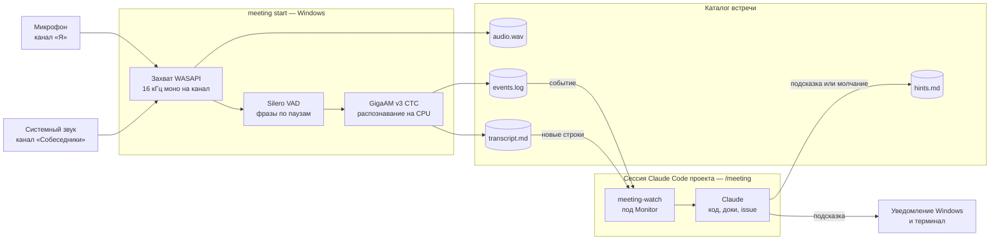
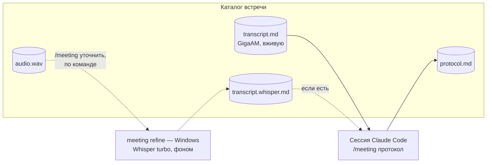

# Устройство

Две части: приложение записи под Windows и скилл `/meeting` для Claude Code; подсказка показывается уведомлением
Windows и в терминале сессии. Связь между частями — только файлы в каталоге встречи.

Во время встречи:



После встречи:



## Структура кода: Clean Architecture + DDD

Слои с зависимостями внутрь, богатая доменная модель, сценарии в Application (CQRS), внешний мир за портами.

```
src/
  MeetingAssistant.SharedKernel/    ← Entity, AggregateRoot, IDomainEvent, DomainException, Result, Error
  MeetingAssistant.Domain/          ← агрегат Meeting, Utterance, Channel, правила пробуждения; знает только SharedKernel
  MeetingAssistant.Application/     ← сценарии (StartMeeting, StopMeeting, RecognizeSpeech, RefineMeeting), ICommand/IQuery, порты
  MeetingAssistant.Infrastructure/  ← по внешним системам: Audio/ (NAudio), Speech/ (sherpa-onnx, Whisper.net), Storage/ (файлы встречи)
  MeetingAssistant.Cli/             ← точка входа: команды, DI, конфиг, Ctrl+C
tests/
  MeetingAssistant.Domain.UnitTests/
  MeetingAssistant.Application.UnitTests/
  MeetingAssistant.Infrastructure.IntegrationTests/  ← настоящие модели sherpa-onnx и файлы во временном каталоге
  MeetingAssistant.ArchitectureTests/                ← правило зависимостей слоёв (NetArchTest)
```

Правило зависимостей проверяется тестом, а не договорённостью: Domain не знает Application, Infrastructure, NAudio
и sherpa-onnx; Application не знает Infrastructure.

- **Domain.** Агрегат `Meeting` (Guid-идентификатор, имя, начало, состояние «идёт/остановлена») владеет
  последовательностью реплик: выдаёт сквозной номер `Utterance`, хранит счётчик речи с последнего события и решает,
  будит ли реплика сессию. Правила пробуждения (`WakePolicy`: обращение, вопрос, термин, накопилось) — доменная логика,
  а не код записи в файл: их и будем крутить по итогам замеров. Value objects: `Channel` (Я / Собеседники),
  `SpeechSpan` (начало и длительность от старта записи), `WakeReason`, `Glossary`. Доменные события:
  `UtteranceRecorded`, `SessionWakeRequested`, `MeetingStopped`. Нарушение инварианта — `DomainException` с кодом
  из `MeetingErrors`.
- **Application.** Команды и обработчики: `StartMeeting`, `StopMeeting`, `RecognizeSpeech` (фраза канала →
  распознавание → `Meeting.Record`). Ожидаемый отказ — `Result` с кодом (`MeetingScenarioErrors`). Файлы пишет не
  обработчик, а подписчики доменных событий: диспетчер доставляет события в порядке подъёма, поэтому строка
  транскрипта всегда записана раньше события, которое на неё ссылается. Порты: `ISpeechRecognizer`,
  `IMeetingStorage` (каталог встречи), `ICurrentMeeting` (встреча процесса и `current.json`), `ITranscriptWriter`,
  `IWakeEventWriter`; время — `TimeProvider`.
- **Конвейер записи** (`IMeetingRecorder`, Application) одинаков для записи с диска и живого захвата:
  - источник звука (`IAudioSource`) отдаёт куски каналов;
  - у каждого канала свой детектор речи (`IVoiceActivityDetectorFactory`);
  - фразы обоих каналов идут в одну очередь в памяти, у неё один читатель — он распознаёт и записывает фразы,
    он же в конце останавливает встречу. Агрегат `Meeting` не потокобезопасен, и второго потока у него нет;
  - очередь без ограничения размера: переполнение остановило бы захват;
  - Ctrl+C прекращает подачу звука; уже вырезанные фразы распознаются, и `конец записи` пишется;
  - потеря устройства (`AudioSourceException` источника) — то же, что Ctrl+C, но `meeting` выходит с ошибкой;
  - исключение записи строки или WAV останавливает конвейер без `конец записи`.
- **Infrastructure.** Реализации портов, папки по внешним системам. sherpa-onnx и NAudio видит только этот слой.
- **Cli.** Только точка входа и сборка DI; логики нет.
- Хранилища как такового нет: состояние встречи живёт в процессе, файлы — проекция. Перезапуск посреди встречи
  начинает новую встречу (пересмотреть, если понадобится продолжение).

## 1. Приложение записи ([#1](https://github.com/juk-777/MeetingAssistant/issues/1))

Консольное приложение .NET 10 под Windows, один процесс.

- **Захват.** `WasapiRecorder` из `NAudio.Wasapi` в общем режиме на устройствах Windows по умолчанию: запись —
  «Я», loopback вывода — «Собеседники». Имена устройств `meeting start` печатает на старте.
  - Пакеты обоих устройств только копируются в очередь в памяти; перевод — на стороне читателя.
  - Каждый канал отдельно переводится в 16 кГц моно float: каналы устройства усредняются, частота — `WdlResampler`
    из `NAudio.Core`. Принимаются float 32 и PCM 16.
  - Время пакета — время записи первого кадра на устройстве (`QPCPosition`, те же часы, что у встречи; нет отметки
    или она дальше 2 с от прихода — пакет кончается в момент прихода). Сплошной
    поток идёт подряд: часы устройств не выравниваются. На разрыве (пакет начался не там, где кончился предыдущий,
    больше чем на 50 мс) пакет ставится на своё время: тишина перед ним или срез начала, уже закрытого тишиной.
  - Канал без пакетов получает тишину по часам процесса до «сейчас минус 500 мс» (loopback молчит, пока ничего
    не звучит; пакеты, помеченные устройством как тишина, `WasapiRecorder` не отдаёт). Запас — на задержку
    доставки: пакет, задержанный меньше, ложится на своё место.
  - Потеря устройства — `AudioSourceException`.
- **Звук на диск.** `audio.wav`: стерео, 16 кГц, PCM 16, левый канал — «Я», правый — «Собеседники». Ровно то, что
  ушло в детектор речи, поэтому `meeting replay audio.wav` повторяет встречу. Заголовок обновляется каждую секунду
  звука: при обрыве процесса файл читается до этого места.
- **Нарезка.** Silero VAD из sherpa-onnx, отдельный экземпляр на канал. Параметры прототипа: порог 0.5,
  `min_silence_duration` 0.5 с, `min_speech_duration` 0.25 с, `max_speech_duration` 20 с. Звук подаётся
  детектору ровно окнами Silero по 512 отсчётов, независимо от того, какими кусками он пришёл
  (`docs/decisions.md`, «sherpa-onnx VAD — только окнами Silero»).
- **Распознавание.** GigaAM v3 CTC с пунктуацией, `OfflineRecognizer` (NeMo CTC), int8, 2 потока, модель грузится
  один раз на старте. Фраза распознаётся целиком после её конца. Очередь фраз общая на оба канала, один распознаватель.
- **Каталог встречи.** `<корень>\<дата>_<время>_<имя>\`: `audio.wav`, `transcript.md`, `events.log`.
  - Дата и время — местные, начала встречи.
  - В имени символы, запрещённые в именах файлов Windows, и управляющие заменяются на `_`, точки и пробелы в конце
    срезаются, длина — до 60 символов. Занятый каталог получает `-2`, `-3`.
  - Строка дописывается открытием файла на одну строку (UTF-8 без BOM).
- **Настройки.** `appsettings.json` рядом с исполняемым файлом:
  - `Storage:MeetingsRoot` — корень встреч;
  - `Speech:ModelsDirectory` — каталог моделей;
  - `Speech:RecognizerThreads` — потоки распознавания.

  Относительные пути считаются от текущего каталога; переопределяются переменными окружения (`Speech__ModelsDirectory`).
  Нет моделей — отказ до начала встречи с командой скачивания. `meeting start` принимает только абсолютный корень
  встреч (переменная окружения пользователя `Storage__MeetingsRoot`): скилл ищет `current.json` там же.
- **`current.json`** — в корне встреч, заменяется целиком через временный файл на старте встречи: `id`, `name`,
  `directory` (абсолютный путь каталога встречи), `startedAt`. Конец встречи виден по `конец записи` в `events.log`.
  Скилл читает его без парсера JSON (`current-field`): формат — плоский объект, `id` и `directory` — строки; вложенный
  объект или массив перед ними, другое имя или тип поля ломают скилл.
- **Управление.**
  - `meeting start "<имя>" [--glossary]` — живой созвон, остановка — Ctrl+C. Настройки, модель, словарь, корень
    и устройства проверяются до каталога встречи. Устройство, занятое в монопольном режиме, видно только при запуске
    захвата — уже после старта встречи, и это как отвал устройства: `конец записи` и код 1. `meeting stop` из другого
    процесса и горячая клавиша — позже.
  - `meeting replay <wav> [--name] [--glossary] [--speed]` — запись с диска через тот же конвейер. Стерео:
    левый канал — «Я», правый — «Собеседники»; моно — «Собеседники». Только 16 кГц, PCM 16 или float 32.
  - В конце обе команды печатают итог: строки, события, время распознавания фразы, CPU процесса и пик памяти.
  - `meeting refine <каталог>` — уточнение законченной встречи (ниже).

### Уточнение встречи ([#20](https://github.com/juk-777/MeetingAssistant/issues/20))

Сценарий `RefineMeeting` (Application) — второй транскрипт `transcript.whisper.md` по звуку `audio.wav`:
- встреча должна быть законченной: в `events.log` есть `конец записи`, иначе отказ до загрузки модели;
- каналы `audio.wav` режет свой Silero VAD на канал с теми же параметрами; подряд идущие фразы канала копятся
  в кусок до окна распознавателя (`SpeechGroup`, у Whisper — 30 с), кусок распознаётся, как только следующая фраза
  в него не помещается, и следующий кусок звука читается только после этого — очереди нет, в памяти не больше
  окна на канал;
- распознаватель — порт `IRefineRecognizer` (окно, подготовка, отрезки текста со временем от начала куска),
  реализация — Whisper large-v3-turbo-q5_0 через Whisper.net: `ru`, без контекста предыдущего куска, половина
  логических процессоров; процесс — с приоритетом «ниже среднего»;
- строка — отрезок Whisper; его начало и конец переводятся на время записи по фразе, в которую попали;
- модель лежит в каталоге моделей рядом с GigaAM, её ставит установка; нет её — `Prepare` отказывает с советом
  повторить установку;
- строки пишутся в `transcript.whisper.md.part`, по окончании он переименовывается; при отмене и сбое удаляется,
  прежний `transcript.whisper.md` цел;
- ход — `IProgress<RefinePosition>` в команде: окно печатает место в записи и оценку остатка, в конце — итог.

Формат строк — как у `transcript.md`; строки по времени записи, номер свой, с 1. Строка — отрезок Whisper, а не
фраза VAD, поэтому строки двух транскриптов сопоставляются по каналу и таймкоду. Кусок редкого канала
распознаётся позже, поэтому строки копятся (только текст) и пишутся в конце. Черновик открыт без совместного
доступа: второе уточнение той же встречи получает отказ.

### Формат `transcript.md`

Строка на фразу, поля через табуляцию:

```
<номер>\t<epoch конца распознавания>\t[чч:мм:сс] <Я|Собеседники>: <текст>
```

Номер — сквозной и монотонный: по нему скилл дочитывает с места остановки. Таймкод — от начала записи,
по началу фразы. Прототип пишет `[мм:сс] текст` без канала — в тестовой записи каналы смешаны.

### Формат `events.log`

```
<epoch>\t<номер строки транскрипта>\t<поводы через запятую>
```

Поводы:
- `обращение` — слово «клод» или «агент» целым словом, без учёта регистра;
- `вопрос` — во фразе есть «?» (GigaAM ставит пунктуацию) и не меньше `WakePolicy.MinQuestionWords` слов:
  короткие «да?», «почему?» обычно риторические и сессию не будят;
- `термин` — совпадение со словарём встречи;
- `накопилось` — набралось 60 с речи без события, чтобы сессия ловила и утверждения, расходящиеся с кодом;
- `конец записи` — последняя строка при остановке.

Событие сбрасывает счётчик «накопилось». Правила событий — главный рычаг стоимости: каждое событие — ход модели
с полным контекстом. По прогону тестовой записи 22 из 29 событий кончились молчанием, причины и правки —
`docs/measurements.md`, «Прогон в реальном темпе», и [#3](https://github.com/juk-777/MeetingAssistant/issues/3).

## 2. Скилл `/meeting` ([#2](https://github.com/juk-777/MeetingAssistant/issues/2))

Исходник — `plugins/meeting/skills/meeting/` репозитория: `SKILL.md` с правилами для сессии и скрипты. Это плагин
Claude Code, репозиторий — его маркетплейс: `/plugin install meeting@meeting-assistant` ставит скилл глобально,
Claude Code держит копию в своём кеше; в рабочей копии `scripts/install-skill.sh` ставит его ссылкой
`~/.claude/skills/meeting`. Скрипты зовутся через `bash` по пути каталога скилла — бит исполнения в кеше плагина
не нужен. Скилл запускается в рабочей сессии проекта, о котором встреча: у неё уже есть код, доки и память
проекта.

- **Приложение записи не установлено** (нет корня встреч или `meeting.exe`) — скрипты выходят с кодом 3; скилл
  предлагает установку и по согласию запускает `meeting-install`: тот качает `install.ps1` последнего релиза
  и запускает его в Windows.

- **Каталог встречи.** `meeting-dir` берёт его из аргумента `/meeting <каталог>` или из `current.json` в корне
  встреч. Корень — `MEETINGS_ROOT`, если задан, иначе переменная пользователя Windows `Storage__MeetingsRoot`
  (её задаёт установка и читает само приложение) — из реестра через `powershell.exe` с выводом в UTF-8: окружение
  WSL переменную, заданную после его старта, не видит, а `reg.exe` отдаёт кириллицу в кодовой странице консоли.
  Путь Windows в WSL переводится через `wslpath`, Git Bash открывает его сам. `current.json` читает `current-field` на bash, без `jq` (в Git for Windows его нет):
  строковое поле JSON с экранированием, эмодзи — суррогатной парой `\uXXXX\uXXXX`.
- **Где идёт сессия.** Claude Code в WSL или прямо в Windows: там скрипты выполняет Git Bash (без него у Claude Code
  в Windows нет `Monitor`). Путь для окна Windows — `windows-path`: `cygpath -w` в Git Bash, `wslpath -w` в WSL;
  неявному переводу Git Bash, который из `/c/x` делает `C:/x`, скрипты не доверяют. Git Bash у Claude Code
  в Windows запущен с выключенным Ctrl+C, и флаг наследуют потомки, поэтому `meeting-start` и `meeting-refine`
  снимают его перед открытием окна. Тесты скилла идут в обеих оболочках.
- **Запуск записи из сессии.** `/meeting start <имя> [словарь]` — `meeting-start` открывает окно `meeting start`
  (`powershell.exe` → `cmd.exe /c`, окно ждёт клавишу и при отказе, и после Ctrl+C: видны причина или итог с CPU
  и памятью), ждёт `current.json`
  с новым `id` и дальше подключается как к идущей встрече. `meeting.exe` — по месту установки, переменные установки
  перечитываются из реестра: окружение WSL их может не видеть. Остановка — Ctrl+C или закрытие окна.
- **Пробуждение — событием, а не таймером.** `Monitor` запускает `meeting-watch`. Скрипт опрашивает `events.log`
  и на каждое событие печатает блок: заголовок события и все строки транскрипта, которых сессия ещё не видела.
  Текст приходит в уведомлении, отдельного чтения нет. Опрос `/loop` раз в 1–2 минуты отвергнут: подсказка
  опаздывала бы на минуты.
- **Состояние чтения** — у скрипта, вне каталога встречи, на пару «встреча, проект». Сжатие контекста его
  не теряет, две сессии разных проектов читают независимо. Строка, которую процесс записи ещё не дописал до
  перевода строки, уходит со следующим событием. Состояние сохраняется после вывода блока: блок, убитый между
  выводом и сохранением, повторится, но не потеряется. Строку, на которую указывает событие, скрипт ждёт
  до 5 с: порядок, в котором WSL видит два файла с диска Windows, не проверялся.
- **Ограничения `Monitor`.**
  - Живёт не больше 30 минут; по истечении сессия получает уведомление и перезапускает его, скрипт продолжает
    с того же места.
  - При слишком частых событиях `Monitor` останавливается сам — поэтому событие не на каждую фразу.
  - Блоки, накопившиеся за ход сессии, приходят одним уведомлением: ответ — на каждый блок.
  - `конец записи` завершает скрипт, после него `Monitor` не перезапускается.
- **Ответ.** Подсказка в 2–3 строки с источником (`файл:строка`, issue, документ) или молчание. Подсказка
  дублируется уведомлением Windows (`meeting-notify` через `powershell.exe`, из WSL и из Windows) и
  `PushNotification` (телефон при Remote Control). Каждое пробуждение — и подсказка, и молчание — пишется строкой в `hints.md`
  (`meeting-hint`): по нему считаются задержка и доля молчаний.
- **Во время встречи — только чтение.** Исключение одно: задача «отправь в <проект>: …» уходит через
  `SendMessage` в сессию того проекта (`ListAgents` — список сессий).
- **Где видно.** Этап 1 — терминал плюс уведомление Windows. Этап 2 — окно поверх остальных, читает `hints.md`.
- **После встречи.** `/meeting протокол` пишет `protocol.md` в каталог встречи: темы, решения, задачи, открытые
  вопросы, у каждого пункта таймкод. Спорные места — по таймкоду с вариантами прочтения. `/meeting уточнить` —
  `meeting-refine` открывает окно `meeting refine` (как `meeting-start`, окно ждёт клавишу и после итога) и сразу
  возвращается; встречу без `конец записи` отвергает сам, не открывая окна. Есть `transcript.whisper.md` —
  протокол сводит оба транскрипта и выносит расхождения в цифрах, сроках, именах отдельным разделом; есть только
  `.part` — пишет по GigaAM с пометкой, что уточнение идёт.

### Вывод `meeting-watch`

Блок — заголовок и строки транскрипта `[чч:мм:сс] Я|Собеседники: текст`. Заголовки:
- `начало<TAB><строк>` — первое подключение, весь транскрипт до этого момента; прошлые события не повторяются;
- `событие<TAB><epoch><TAB><поводы><TAB><номер строки>`;
- `конец записи<TAB><epoch><TAB><номер строки>` — оставшиеся строки, после чего скрипт выходит с кодом 0.
  Перезапуск после конца печатает только этот заголовок и выходит.

### Формат `hints.md`

```
<epoch события>\t<epoch записи>\t<номер строки события>\t<текст подсказки или ->
```

Строки подсказки склеены через ` / `, `-` — молчание.

### Контекст встречи

Сессия помнит всю встречу: каждое пробуждение добавляет в разговор новый кусок транскрипта, и предыдущие куски
остаются в контексте. Поэтому вопрос на 40-й минуте видит, что говорили на 5-й, и то, что сессия уже нашла в коде.
Оценка объёма: 10,7 мин тестовой записи — 18 КБ транскрипта; час — порядка 100 КБ текста, в контекст помещается.
Если контекст всё же сожмётся, ранняя часть останется пересказом, а полный текст лежит в `transcript.md` —
скилл может перечитать нужный кусок по таймкоду.

## 3. Выпуск и установка ([#14](https://github.com/juk-777/MeetingAssistant/issues/14))

- **CI** (`.github/workflows/ci.yml`) — на каждый pull request и слияние в `main`: сборка и `scripts/test.sh`
  на Linux, модели — `scripts/download-models.sh` с кешем по имени архива. Проверка `test` обязательна для `main`.
- **Выпуск** (`release.yml`) — на тег `vX.Y.Z`, стоящий на `main`: `scripts/release-version.sh` сверяет тег
  с версией плагина, тесты, `dotnet publish -r win-x64 --self-contained` с версией тега, релиз GitHub
  с `meeting-win-x64.zip`, его SHA-256 и `install.ps1`; версия с суффиксом — предварительный релиз.
- **Установка** (`scripts/install.ps1`) — в `%LOCALAPPDATA%\MeetingAssistant`: `app`, `models` (GigaAM, VAD,
  Whisper turbo для уточнения — каждая качается, только если её нет), переменные пользователя, `PATH`; порядок —
  скачать и сверить всё, затем заменить `app`, модели, переменные.
- **Скилл** — плагин `meeting` маркетплейса `meeting-assistant` (раздел 2).

## Данные

Звук, файлы встречи и модели хранятся на машине. Наружу (в Anthropic) уходит текст: весь транскрипт встречи,
к которой подключена сессия, и оба транскрипта, когда она пишет протокол. Звук не уходит никуда. Это тот же
получатель и те же условия, что для кода проекта; новых сервисов, получающих разговор, нет. Granola и облачные
аналоги отвергнуты как раз из-за отправки звука и текста третьим сторонам (`docs/decisions.md`). Чтобы не уходил
и текст, вместо Claude нужна локальная модель — это другая задача.
