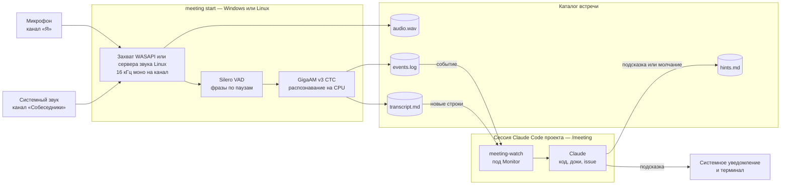
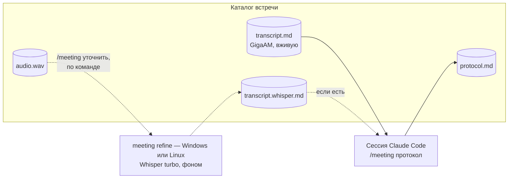

# Устройство

Две части: приложение записи под Windows и Linux и скилл `/meeting` для Claude Code; подсказка показывается
системным уведомлением и в терминале сессии, в режиме собеседования — ещё в отдельном окне подсказок. Связь между
частями — только файлы в каталоге встречи.

Во время встречи:



После встречи:



## Структура кода: Clean Architecture + DDD

Слои с зависимостями внутрь, богатая доменная модель, сценарии в Application (CQRS), внешний мир за портами.

```
src/
  MeetingAssistant.SharedKernel/    ← Entity, AggregateRoot, IDomainEvent, DomainException, Result, Error
  MeetingAssistant.Domain/          ← агрегат Meeting, Utterance, Channel, правила пробуждения, правило смены экрана; знает только SharedKernel
  MeetingAssistant.Application/     ← сценарии (StartMeeting, StopMeeting, RecognizeSpeech, ObserveSpeech, RefineMeeting), наблюдение экрана, ICommand/IQuery, порты
  MeetingAssistant.Infrastructure/  ← по внешним системам: Audio/ (NAudio), Speech/ (sherpa-onnx, Whisper.net), Screen/ (GDI, libX11, PNG), Storage/ (файлы встречи)
  MeetingAssistant.Cli/             ← точка входа: команды, DI, конфиг, Ctrl+C
tests/
  MeetingAssistant.Domain.UnitTests/
  MeetingAssistant.Application.UnitTests/
  MeetingAssistant.Infrastructure.IntegrationTests/  ← настоящие модели sherpa-onnx и файлы во временном каталоге
  MeetingAssistant.ArchitectureTests/                ← правило зависимостей слоёв (NetArchTest)
```

Правило зависимостей проверяется тестом, а не договорённостью: Domain не знает Application, Infrastructure, NAudio
и sherpa-onnx; Application не знает Infrastructure.

- **Domain.** Агрегат `Meeting` (Guid-идентификатор, имя, начало, состояние «идёт/остановлена») владеет
  последовательностью реплик: выдаёт сквозной номер `Utterance`, хранит счётчик речи с последнего события и решает,
  будит ли реплика сессию. Правила пробуждения (`WakePolicy`: обращение, вопрос, термин, накопилось) — доменная логика,
  а не код записи в файл: их и будем крутить по итогам замеров. Тем же способом агрегат следит за ответом
  «Собеседников» и по речи каналов (`Meeting.Observe`) решает, кончился ли он (`AnswerEndPolicy`). Value objects:
  `Channel` (Я / Собеседники), `SpeechSpan` (начало и длительность от старта записи), `SpeechActivity` (докуда дошёл
  звук канала и с какого момента в нём идёт речь), `WakeReason`, `Glossary`. Доменные события: `UtteranceRecorded`,
  `SessionWakeRequested`, `AnswerEnded`, `MeetingStopped`. Нарушение инварианта — `DomainException` с кодом
  из `MeetingErrors`.
- **Application.** Команды и обработчики: `StartMeeting`, `StopMeeting`, `RecognizeSpeech` (фраза канала →
  распознавание → `Meeting.Record`), `ObserveSpeech` (речь каналов → `Meeting.Observe`). Ожидаемый отказ —
  `Result` с кодом (`MeetingScenarioErrors`). Файлы пишет не
  обработчик, а подписчики доменных событий: диспетчер доставляет события в порядке подъёма, поэтому строка
  транскрипта всегда записана раньше события, которое на неё ссылается. Порты: `ISpeechRecognizer`,
  `IMeetingStorage` (каталог встречи), `ICurrentMeeting` (встреча процесса и `current.json`), `ITranscriptWriter`,
  `IWakeEventWriter`; время — `TimeProvider`.
- **Конвейер записи** (`IMeetingRecorder`, Application) одинаков для записи с диска и живого захвата:
  - источник звука (`IAudioSource`) отдаёт куски каналов;
  - у каждого канала свой детектор речи (`IVoiceActivityDetectorFactory`);
  - фразы обоих каналов идут в одну очередь в памяти, у неё один читатель — он распознаёт и записывает фразы,
    он же в конце останавливает встречу. Агрегат `Meeting` не потокобезопасен, и второго потока у него нет;
  - после каждого куска в ту же очередь, следом за фразами, которые кусок закрыл, встаёт речь обоих каналов
    (`ObserveSpeech`: позиция звука канала и начало идущей речи — `IVoiceActivityDetector.SpeakingSince`, у Silero —
    `IsSpeechDetected` по окнам): конец ответа сверяется с уже записанными фразами;
  - очередь без ограничения размера: переполнение остановило бы захват;
  - Ctrl+C прекращает подачу звука; уже вырезанные фразы распознаются, и `конец записи` пишется;
  - потеря устройства (`AudioSourceException` источника) — то же, что Ctrl+C, но `meeting` выходит с ошибкой;
  - исключение записи строки или WAV останавливает конвейер без `конец записи`.
- **Infrastructure.** Реализации портов, папки по внешним системам. sherpa-onnx и NAudio видит только этот слой.
- **Cli.** Только точка входа и сборка DI; логики нет.
- Хранилища как такового нет: состояние встречи живёт в процессе, файлы — проекция. Перезапуск посреди встречи
  начинает новую встречу (пересмотреть, если понадобится продолжение).

## 1. Приложение записи ([#1](https://github.com/juk-777/MeetingAssistant/issues/1))

Консольное приложение .NET 10 под Windows и Linux, один процесс. Запускается в ОС, на которой идёт созвон, —
не в WSL: системного звука Windows там нет.

- **Захват.** Устройства по умолчанию, ОС выбирает реализацию (`LiveCapture`). Имена устройств `meeting start`
  печатает на старте.
  - Windows — `WasapiRecorder` из `NAudio.Wasapi` в общем режиме: запись — «Я», loopback вывода — «Собеседники».
  - Linux — сервер звука через `libpulse-simple` (пакет `libpulse0`, вызовы P/Invoke): микрофон по умолчанию
    (`@DEFAULT_SOURCE@`) — «Я», монитор устройства вывода по умолчанию (`@DEFAULT_MONITOR@`) — «Собеседники».
    Протокол PulseAudio понимает и PipeWire через `pipewire-pulse`. Сервер сам отдаёт s16le 16 кГц моно кусками по
    100 мс. Чтение блокирующее, в своём потоке на устройство. Отметка пакета — приход минус задержка
    `pa_simple_get_latency` и длина пакета. Нет библиотеки — отказ до каталога встречи с пакетом, который поставить.
  - Пакеты обоих устройств только копируются в очередь в памяти; перевод — на стороне читателя.
  - Каждый канал отдельно переводится в 16 кГц моно float: каналы устройства усредняются, частота — `WdlResampler`
    из `NAudio.Core`. Принимаются float 32 и PCM 16.
  - Время пакета — время записи первого кадра на устройстве (у WASAPI — `QPCPosition`, те же часы, что у встречи;
    нет отметки или она дальше 2 с от прихода — пакет кончается в момент прихода). Сплошной
    поток идёт подряд: часы устройств не выравниваются. На разрыве (пакет начался не там, где кончился предыдущий,
    больше чем на 50 мс) пакет ставится на своё время: тишина перед ним или срез начала, уже закрытого тишиной.
  - Канал без пакетов получает тишину по часам процесса до «сейчас минус 500 мс» (loopback молчит, пока ничего
    не звучит; пакеты, помеченные устройством как тишина, `WasapiRecorder` не отдаёт). Запас — на задержку
    доставки: пакет, задержанный меньше, ложится на своё место.
  - Потеря устройства — `AudioSourceException`.
- **Звук на диск.** `audio.wav`: стерео, 16 кГц, PCM 16, левый канал — «Я», правый — «Собеседники». Ровно то, что
  ушло в детектор речи, поэтому `meeting replay audio.wav` повторяет встречу. Заголовок обновляется каждую секунду
  звука: при обрыве процесса файл читается до этого места.
- **Нарезка.** Silero VAD из sherpa-onnx, отдельный экземпляр на канал. Параметры прототипа: порог 0.5,
  `min_silence_duration` 0.5 с, `min_speech_duration` 0.25 с, `max_speech_duration` 20 с. Последний — порог, а
  не предел: фраза длиннее режется на первой короткой паузе, жёсткого предела длины нет (на записях созвонов p99 —
  25 с, max — 35.6 с; `docs/decisions.md`, «sherpa-onnx VAD: `max_speech_duration` — порог»). Звук подаётся
  детектору ровно окнами Silero по 512 отсчётов, независимо от того, какими кусками он пришёл
  (`docs/decisions.md`, «sherpa-onnx VAD — только окнами Silero»).
- **Распознавание.** GigaAM v3 CTC с пунктуацией, `OfflineRecognizer` (NeMo CTC), int8, 2 потока, модель грузится
  один раз на старте. Фраза распознаётся целиком после её конца. Очередь фраз общая на оба канала, один распознаватель.
- **Каталог встречи.** `<корень>\<дата>_<время>_<имя>\`: `audio.wav`, `transcript.md`, `events.log`.
  - Дата и время — местные, начала встречи.
  - В имени символы, запрещённые в именах файлов Windows, и управляющие заменяются на `_`, точки и пробелы в конце
    срезаются, длина — до 60 символов. Занятый каталог получает `-2`, `-3`.
  - Строка дописывается открытием файла на одну строку (UTF-8 без BOM).
- **Настройки.** `appsettings.json` рядом с исполняемым файлом:
  - `Storage:MeetingsRoot` — корень встреч;
  - `Speech:ModelsDirectory` — каталог моделей;
  - `Speech:RecognizerThreads` — потоки распознавания;
  - `Speech:RefineThreads` — потоки Whisper при уточнении, не больше половины логических процессоров; проверяет
    уточнение (не целое от 1 или не задана — отказ до загрузки модели), запись от неё не зависит, даже от
    нечислового значения.

  Относительные пути считаются от текущего каталога; переопределяются переменными окружения (`Speech__ModelsDirectory`).
  Нет моделей — отказ до начала встречи с командой скачивания. `meeting start` принимает только абсолютный корень
  встреч (переменная окружения пользователя `Storage__MeetingsRoot`): скилл ищет `current.json` там же.
- **`current.json`** — в корне встреч, заменяется целиком через временный файл на старте встречи: `id`, `name`,
  `directory` (абсолютный путь каталога встречи), `startedAt`. Конец встречи виден по `конец записи` в `events.log`.
  Скилл читает его без парсера JSON (`current-field`): формат — плоский объект, `id` и `directory` — строки; вложенный
  объект или массив перед ними, другое имя или тип поля ломают скилл.
- **Управление.**
  - `meeting start "<имя>" [--glossary] [--screen [<монитор>]]` — живой созвон, остановка — Ctrl+C; экран —
    раздел 2, «Экран встречи». Настройки, модель, словарь, корень, устройства и экран проверяются до каталога
    встречи. Устройство, занятое в монопольном режиме, видно только при запуске захвата — уже после старта встречи,
    и это как отвал устройства: `конец записи` и код 1. `meeting stop` из другого процесса и горячая клавиша —
    позже.
  - `meeting replay <wav> [--name] [--glossary] [--speed]` — запись с диска через тот же конвейер. Стерео:
    левый канал — «Я», правый — «Собеседники»; моно — «Собеседники». Только 16 кГц, PCM 16 или float 32.
  - В конце обе команды печатают итог: строки, события, время распознавания фразы, CPU процесса и пик памяти.
  - `meeting refine <каталог>` — уточнение законченной встречи (ниже).

### Уточнение встречи ([#20](https://github.com/juk-777/MeetingAssistant/issues/20))

Сценарий `RefineMeeting` (Application) — второй транскрипт `transcript.whisper.md` по звуку `audio.wav`:
- встреча должна быть законченной: в `events.log` есть `конец записи`, иначе отказ до загрузки модели;
- каналы `audio.wav` режет свой Silero VAD на канал с теми же параметрами; подряд идущие фразы канала копятся
  в кусок до окна распознавателя (`SpeechGroup`, у Whisper — 30 с), кусок распознаётся, как только следующая фраза
  в него не помещается, и следующий кусок звука читается только после этого — очереди нет, в памяти не больше
  окна на канал;
- распознаватель — порт `IRefineRecognizer` (окно, подготовка, отрезки текста со временем от начала куска),
  реализация — Whisper large-v3-turbo-q5_0 через Whisper.net: `ru`, без контекста предыдущего куска, потоки —
  `Speech:RefineThreads`, но не больше половины логических процессоров; процесс — с приоритетом «ниже среднего»;
- строка — отрезок Whisper; его начало и конец переводятся на время записи по фразе, в которую попали;
- модель лежит в каталоге моделей рядом с GigaAM, её ставит установка; нет её — `Prepare` отказывает с советом
  повторить установку;
- строки пишутся в `transcript.whisper.md.part`, по окончании он переименовывается; при отмене и сбое удаляется,
  прежний `transcript.whisper.md` цел; ни одной строки — отказ `Refine.NothingRecognized` с речью в секундах, `.part`
  так же удаляется: пустой второй транскрипт выдал бы себя за результат;
- ход — `IProgress<RefinePosition>` в команде: окно печатает место в записи и оценку остатка, в конце — итог.

Формат строк — как у `transcript.md`; строки по времени записи, номер свой, с 1. Строка — отрезок Whisper, а не
фраза VAD, поэтому строки двух транскриптов сопоставляются по каналу и таймкоду. Кусок редкого канала
распознаётся позже, поэтому строки копятся (только текст) и пишутся в конце. Черновик открыт без совместного
доступа: второе уточнение той же встречи получает отказ.

### Формат `transcript.md`

Строка на фразу, поля через табуляцию:

```
<номер>\t<epoch конца распознавания>\t[чч:мм:сс] <Я|Собеседники>: <текст>
```

Номер — сквозной и монотонный: по нему скилл дочитывает с места остановки. Таймкод — от начала записи,
по началу фразы. Прототип пишет `[мм:сс] текст` без канала — в тестовой записи каналы смешаны.

### Формат `events.log`

```
<epoch>\t<номер строки транскрипта>\t<поводы через запятую>
```

Поводы:
- `обращение` — «агент» в любом падеже единственного числа («агента», «агенту»…) целым словом, без учёта
  регистра; множественное число и производные («агентство») — нет. Это слово GigaAM пишет верно: имя «Клод» он
  выдаёт как «клот», «флот» или теряет (`docs/decisions.md`);
- `вопрос` — во фразе есть «?» (GigaAM ставит пунктуацию) и не меньше `WakePolicy.MinQuestionWords` слов:
  короткие «да?», «почему?» обычно риторические и сессию не будят;
- `термин` — совпадение со словарём встречи. Шаблоны собираются без возврата (`RegexOptions.NonBacktracking`):
  сопоставление линейно по длине фразы, а обратные ссылки, проверки вперёд и назад, атомарные группы, условия и
  повторы сверх предела автомата отказывают при разборе словаря, на старте записи (`docs/decisions.md`);
- `накопилось` — набралось 60 с речи без события, чтобы сессия ловила и утверждения, расходящиеся с кодом;
- `конец ответа` — «Собеседники» закончили ответ от 10 с: 2.5 с тишины обоих каналов или речь «Я» дольше 1 с,
  начатая после ответа, пока «Собеседники» молчат (`AnswerEndPolicy`). Номер — последняя строка ответа. С другими
  поводами не сочетается и сессию не будит: его читает окно подсказок интервьюеру (`docs/decisions.md`, «Роль
  интервьюера»). Пишется в любом режиме — режима приложение не знает. Реплика короче 10 с, после которой
  заговорил «Я», ответом не считается: события нет, отсчёт ответа — со следующей фразы «Собеседников»;
- `конец записи` — последняя строка при остановке.

Читатели — `meeting-watch`, окна подсказок, `prototype/events_stats.py`, `wake_gate_eval.py`,
`interview_replay_check.py`: новый повод сверяется с каждым, иначе он молча идёт в чужой счёт.

Событие, кроме `конец ответа`, сбрасывает счётчик «накопилось». Правила событий — главный рычаг стоимости:
каждое событие — ход модели с полным контекстом. На записях созвонов 56 из 93 событий кончились молчанием. Фильтр
перед сессией (Haiku-ворота, правило вопроса) замерен и отвергнут: `docs/decisions.md`, «Сессию будит событие,
а не таймер», `docs/measurements.md`, «Фильтр пробуждений».

## 2. Скилл `/meeting` ([#2](https://github.com/juk-777/MeetingAssistant/issues/2))

Исходник — `plugins/meeting/skills/meeting/` репозитория: `SKILL.md` с правилами для сессии и скрипты. Это плагин
Claude Code, репозиторий — его маркетплейс: `/plugin install meeting@meeting-assistant` ставит скилл глобально,
Claude Code держит копию в своём кеше; в рабочей копии `scripts/install-skill.sh` ставит его ссылкой
`~/.claude/skills/meeting`. Скрипты зовутся через `bash` по пути каталога скилла — бит исполнения в кеше плагина
не нужен. Скилл запускается в рабочей сессии проекта, о котором встреча: у неё уже есть код, доки и память
проекта. В каталоге без проекта он тоже работает — остаются общие подсказки.

- **Приложение записи не установлено** (нет корня встреч или `meeting.exe`) — скрипты выходят с кодом 3; скилл
  предлагает установку и по согласию запускает `meeting-install`: тот качает `install.ps1` последнего релиза
  и запускает его в Windows, на Linux — `install.sh`.
- **Приложение старее плагина** — `meeting-start` и `meeting-refine` до окна зовут `check-app-version`: версия
  `meeting --version` против `version` из `plugin.json` плагина, числами `X.Y.Z`. Старее или не распознана — код 4,
  скилл предлагает тот же `meeting-install`; сборка `-dev` и `MEETING_ANY_APP_VERSION=1` — без сверки.
  Подключение к идущей встрече версию не сверяет: обновить приложение во время записи нельзя.

- **Каталог встречи.** `meeting-dir` берёт его из аргумента `/meeting <каталог>` или из `current.json` в корне
  встреч. Корень — `MEETINGS_ROOT`, если задан, иначе переменная пользователя Windows `Storage__MeetingsRoot`
  (её задаёт установка и читает само приложение) — из реестра через `powershell.exe` с выводом в UTF-8: окружение
  WSL переменную, заданную после его старта, не видит, а `reg.exe` отдаёт кириллицу в кодовой странице консоли.
  Путь Windows в WSL переводится через `wslpath`, Git Bash открывает его сам. На Linux корень, модели и `meeting`
  называет `linux-setting`: корень и модели — из блока `meeting-assistant` в `~/.profile`, который пишет
  `install.sh`, иначе из окружения. Окружение сессии блока, дописанного после входа в систему, не видит.
  `current.json` читает `current-field` на bash, без `jq` (в Git for Windows его нет):
  строковое поле JSON с экранированием, эмодзи — суррогатной парой `\uXXXX\uXXXX`.
- **Где идёт сессия.** ОС называет `platform` по `powershell.exe`: он есть — Windows (WSL, Git Bash), нет и ОС
  Linux не в WSL — Linux. WSL без `powershell.exe` — отказ: путь Linux записал бы встречу без системного звука
  Windows. Claude Code в WSL или прямо в Windows: там скрипты выполняет Git Bash (без него у Claude Code
  в Windows нет `Monitor`). Путь для окна Windows — `windows-path`: `cygpath -w` в Git Bash, `wslpath -w` в WSL;
  неявному переводу Git Bash, который из `/c/x` делает `C:/x`, скрипты не доверяют. Git Bash у Claude Code
  в Windows запущен с выключенным Ctrl+C, и флаг наследуют потомки, поэтому `meeting-start` и `meeting-refine`
  снимают его перед открытием окна. Тесты скилла идут в обеих оболочках.
- **Запуск записи из сессии.** `/meeting start <имя> [словарь]` — `meeting-start` открывает окно `meeting start`
  (`powershell.exe` → `cmd.exe /c`, окно ждёт клавишу и при отказе, и после Ctrl+C: видны причина или итог с CPU
  и памятью), ждёт `current.json`
  с новым `id` и дальше подключается как к идущей встрече. `meeting.exe` — по месту установки, переменные установки
  перечитываются из реестра: окружение WSL их может не видеть. Остановка — Ctrl+C или закрытие окна. На Linux окно
  открывает `linux-window` в эмуляторе терминала по списку: `xdg-terminal-exec` (терминал, выбранный в системе),
  `ptyxis`, `x-terminal-emulator`, `gnome-terminal`, `konsole`, `xfce4-terminal`, `xterm`. Эмулятор, отказавший на
  старте, пропускается: поставщик `x-terminal-emulator` может не знать `-e` (Ptyxis в Ubuntu 26.04). Аргументы
  `meeting` уходят окну позиционными параметрами `bash -c`, окно ждёт клавишу так же. Ни один не открыл окно —
  отказ с командой для ручного запуска.
- **Пробуждение — событием, а не таймером.** `Monitor` запускает `meeting-watch`. Скрипт опрашивает `events.log`
  и на каждое событие, кроме `конец ответа`, печатает блок: заголовок события и все строки транскрипта, которых
  сессия ещё не видела.
  Текст приходит в уведомлении, отдельного чтения нет. Опрос `/loop` раз в 1–2 минуты отвергнут: подсказка
  опаздывала бы на минуты.
- **Состояние чтения** — у скрипта, вне каталога встречи, на пару «встреча, проект». Сжатие контекста его
  не теряет, две сессии разных проектов читают независимо. Строка, которую процесс записи ещё не дописал до
  перевода строки, уходит со следующим событием. Состояние сохраняется после вывода блока: блок, убитый между
  выводом и сохранением, повторится, но не потеряется. Строку, на которую указывает событие, скрипт ждёт
  до 5 с: порядок, в котором WSL видит два файла с диска Windows, не проверялся.
- **Ограничения `Monitor`.**
  - Живёт не больше 30 минут, в `claude -p` (2.1.325) — 10 минут при запрошенных 30; по истечении сессия получает
    уведомление и перезапускает его, скрипт продолжает с того же места (`docs/measurements.md`, «Скилл `/meeting`
    на записях созвонов»).
  - При слишком частых событиях `Monitor` останавливается сам — поэтому событие не на каждую фразу.
  - Блоки, накопившиеся за ход сессии, приходят одним уведомлением: ответ — на каждый блок.
  - `конец записи` завершает скрипт, после него `Monitor` не перезапускается.
- **Ответ.** Подсказка или молчание. О проекте — со сверкой чтением и источником (`файл:строка`, issue, документ);
  общий вопрос — из знаний модели, последней строкой `общее`. Подсказка — сначала всплывающее уведомление с сутью
  (`meeting-notify`: в Windows — `powershell.exe` из WSL и Git Bash, на Linux — `notify-send`; только у встречи
  с отметкой `notify`, ниже), затем карточка в чате: реплика с таймкодом, суть, 2–4 строки деталей, источник; при
  отставании детали — только у последней.
  `PushNotification` (телефон при Remote Control) — только если пользователь попросил подсказки на телефон.
  Молчание — один символ `—` в чате. Каждое пробуждение — и подсказка, и молчание — пишется строкой в `hints.md`
  (`meeting-hint`: суть и источник или `-`): по нему считаются задержка и доля молчаний.
- **Во время встречи — только чтение.** Исключение одно: задача «отправь в <проект>: …» уходит через
  `SendMessage` в сессию того проекта (`ListAgents` — список сессий).
- **Где видно.** Терминал сессии; в режиме собеседования — ещё окно подсказок (`hint-window`, ниже). Системное
  уведомление (суть подсказки сессии, первая строка ответа окна) — только у встречи, запущенной с `--notify`.
- **После встречи.** `/meeting протокол` пишет `protocol.md` в каталог встречи: темы, решения, задачи, открытые
  вопросы, у каждого пункта таймкод. Спорные места — по таймкоду с вариантами прочтения. `/meeting уточнить` —
  `meeting-refine` открывает окно `meeting refine` (как `meeting-start`, окно ждёт клавишу и после итога) и сразу
  возвращается; встречу без `конец записи` отвергает сам, не открывая окна. Есть непустой `transcript.whisper.md` —
  протокол сводит оба транскрипта и выносит расхождения в цифрах, сроках, именах отдельным разделом (пустой, от
  версий до отказа без строк, — как его нет); есть только `.part` — пишет по GigaAM с пометкой, что уточнение идёт.
- **Режим кандидата** (`--mode candidate`, #11). `meeting-mode` пишет в каталог встречи `mode.json` (режим,
  контекст одной строкой, модель) и `notes.md` (заметки подряд) и открывает окно `hint-window` (окно роли по режиму
  встречи; общая часть окон — `hint-answer`): на Linux —
  `linux-terminal` (тот же перебор эмуляторов, что у окна записи), в Windows — `Start-Process` через
  `powershell.exe` (из WSL — `wsl.exe` в том же дистрибутиве, из Git Bash — bash Git). В окне `meeting-candidate`:
  опрос `transcript.md` раз в 0.3 с, на каждую новую строку «Собеседники» от 3 слов — `claude -p` (effort low, без
  инструментов, MCP и настроек; роль, контекст и заметки — своим системным промптом `--system-prompt-file`, на входе —
  последние строки и сама реплика) с ответом `stream-json`, разбор дельт без jq (awk), печать по мере прихода; новая
  реплика гасит группу процессов прошлого ответа; первая строка — `meeting-notify`; ответ — блоком в `candidate.md`.
  Сессия в этом режиме на пробуждения молчит, кроме `обращение`; протокол — разделы собеседования.
- **Режим интервьюера** (`--mode interviewer`, #11). То же окно, в нём `meeting-interviewer`: опрос `events.log` и
  `marks.log`; на `конец ответа` и на отметку `оцени` (`meeting-mark` по слову в чате сессии) — `claude -p` тем же
  быстрым путём, на входе — последние строки и ответ кандидата: строки «Собеседников» после последней дописанной
  подсказки. Ответ — оценка (`верно`, `неполно`, `ошибка`) и 1–2 уточняющих вопроса; первая строка без оценки —
  не подсказка: без уведомления, в журнал «нет подсказки»; новый повод гасит прошлый ответ; журнал —
  `interviewer.md`. Сессия на пробуждения молчит, кроме `обращение`; протокол — вопросы с оценками и вывод.
- **Сообщение в чате** во время встречи в любом режиме — вопрос к сессии: ответ карточкой, как на обращение.

### Вывод `meeting-watch`

Блок — заголовок и строки транскрипта `[чч:мм:сс] Я|Собеседники: текст`. Заголовки:
- первое подключение к идущей встрече ничего не печатает: прошлые события не повторяются, а транскрипт до этого
  момента уходит с первым блоком — блок без события дал бы сессии ход, на который нечего ответить; подключение
  к законченной встрече сразу отдаёт конец записи со всем транскриптом;
- `событие<TAB><epoch><TAB><поводы><TAB><номер строки>`; `конец ответа` блока не даёт — его строки уходят со
  следующим событием;
- `конец записи<TAB><epoch><TAB><номер строки>` — оставшиеся строки, после чего скрипт выходит с кодом 0.
  Перезапуск после конца печатает только этот заголовок и выходит.

### Формат `hints.md`

```
<epoch события>\t<epoch записи>\t<номер строки события>\t<текст подсказки или ->
```

Строки подсказки склеены через ` / `, `-` — молчание.

### Отметка `notify` ([#81](https://github.com/juk-777/MeetingAssistant/issues/81))

`notify` — пустой файл в каталоге встречи: уведомления этой встречи включены. Ставит `meeting-start --notify`,
проверяет `meeting-notify <каталог встречи> <текст>` — оба источника уведомлений (сессия и окно подсказок) зовут его
всегда. Нет файла — уведомления нет: на показе экрана оно всплыло бы на показанном мониторе. У идущей встречи
включается руками — `touch <каталог встречи>/notify`.

### Файлы режима собеседования

- `mode.json` — `{"mode": "candidate|interviewer", "context": "<строка>", "model": "<модель>", "screenModel":
  "<модель>"}`, плоский JSON: пишет `meeting-mode`, читает `current-field`, как `current.json`.
- `notes.md` — заметки `--notes` подряд, каждая под заголовком `# <имя файла>`.
- `marks.log` — строка `<epoch>` на отметку `оцени` (пишет `meeting-mark`, читает окно интервьюера).
- `candidate.md`, `interviewer.md` — журнал окна: блок `## [чч:мм:сс] <повод или реплика>`, под ним ответ модели;
  `-` и ответ без подсказки — `(нет ответа)` у кандидата, `(нет подсказки)` у интервьюера, оборванный — с
  `… (прервано)`.

### Экран встречи ([#57](https://github.com/juk-777/MeetingAssistant/issues/57))

С ключом `--screen` приложение снимает монитор, а окно подсказок переводит смены экрана в текст.

- **Снимок** — `IScreenSource` раз в `ScreenChangePolicy.CaptureInterval` (1 с): Windows — GDI `BitBlt` монитора по
  номеру (основной — 1, процесс DPI-aware по мониторам), Linux — `XGetImage` корневого окна `libX11`, весь экран X.
  Отказы до каталога встречи: Wayland, нет дисплея или `libX11`, номер монитора на Linux, нет монитора с номером.
- **Смена** — `ScreenChangePolicy` (Domain) на сетке 64×36 средних яркостей: изменение против записанного экрана
  больше 4 из 255 хотя бы в 5 ячейках, неподвижное 3 с, не раньше 10 с после прошлой смены. Ячейки, меняющиеся на
  каждом снимке, не устаиваются; живая ячейка (от 3 изменений за 30 с — видео в окне звонка) не считается.
- **Цикл** — `ScreenWatcher` (Application) рядом с конвейером записи, мимо очереди фраз и агрегата: смену экрана
  ни с чем в транскрипте не связывают. Гасится до `конец записи`; сбой снимка или записи — предупреждение в лог,
  запись звука идёт дальше. Время — по часам от начала встречи.
- **Файлы** (пишет `ScreenFiles`, один писатель): `screen/<чч-мм-сс>.png` — снимок, уменьшенный до 1568 точек по
  длинной стороне (свой кодировщик PNG); затем строка `<epoch>\t<файл>` в `screen.log`. `events.log` смены экрана не
  получает: сессию она не будит.
- **Описание** — `screen-describe` в окне подсказок: на новую строку `screen.log` — вызов `claude -p` со снимком
  (`--input-format stream-json`, модель `screenModel`, по умолчанию `haiku`), блок `## [чч:мм:сс] экран` в
  `screen.md` — только целиком; `-` — `(нет задачи и кода)`. Смена во время описания его не обрывает: после него
  описывается последняя смена. Последнее описание с задачей, кодом или схемой идёт в каждый запрос подсказки;
  кандидату новый раздел `Задача:` (сравнение без пробелов и переводов строк) — сам повод подсказки `задача на
  экране`.

### Контекст встречи

Сессия помнит всю встречу: каждое пробуждение добавляет в разговор новый кусок транскрипта, и предыдущие куски
остаются в контексте. Поэтому вопрос на 40-й минуте видит, что говорили на 5-й, и то, что сессия уже нашла в коде.
Оценка объёма: 10,7 мин тестовой записи — 18 КБ транскрипта; час — порядка 100 КБ текста, в контекст помещается.
Если контекст всё же сожмётся, ранняя часть останется пересказом, а полный текст лежит в `transcript.md` —
скилл может перечитать нужный кусок по таймкоду.

## 3. Выпуск и установка ([#14](https://github.com/juk-777/MeetingAssistant/issues/14))

- **CI** (`.github/workflows/ci.yml`) — на каждый pull request и слияние в `main`: сборка и `scripts/test.sh`
  на Linux, модели — `scripts/download-models.sh` с кешем по имени архива. Проверка `test` обязательна для `main`.
- **Выпуск** (`release.yml`) — на тег `vX.Y.Z`, стоящий на `main`: `scripts/release-version.sh` сверяет тег
  с версией плагина, тесты, `dotnet publish --self-contained` под `win-x64` и `linux-x64` с версией тега, релиз
  GitHub с `meeting-win-x64.zip`, `meeting-linux-x64.tar.gz`, их SHA-256, `install.ps1` и `install.sh`; версия
  с суффиксом — предварительный релиз.
- **Установка** — порядок один: скачать и сверить всё, затем заменить `app`, модели, переменные. Модели — GigaAM,
  VAD, Whisper turbo для уточнения; каждая качается, только если её нет.
  - Windows (`scripts/install.ps1`) — в `%LOCALAPPDATA%\MeetingAssistant`: `app`, `models`, переменные
    пользователя, `PATH`.
  - Linux (`scripts/install.sh`) — в `~/.local/share/meeting-assistant`: `app`, `models`. Ссылка `meeting` — в
    `~/.local/bin`, переменные и `~/.local/bin` в `PATH` — блоком в `~/.profile`.
- **Скилл** — плагин `meeting` маркетплейса `meeting-assistant` (раздел 2).

## Данные

Звук, файлы встречи и модели хранятся на машине. Наружу (в Anthropic) уходит текст: весь транскрипт встречи,
к которой подключена сессия, и оба транскрипта, когда она пишет протокол; в режиме собеседования окно подсказок
отправляет последние 30 строк транскрипта и первые 30 КБ `notes.md` каждым вызовом модели, а с `--screen` — каждый
снимок смены экрана (весь монитор) и его описание. Звук не уходит никуда.
Это тот же получатель и те же условия, что для кода проекта; новых сервисов, получающих разговор, нет. Granola
и облачные аналоги отвергнуты как раз из-за отправки звука и текста третьим сторонам (`docs/decisions.md`). Чтобы
не уходил и текст, вместо Claude нужна локальная модель — это другая задача.
